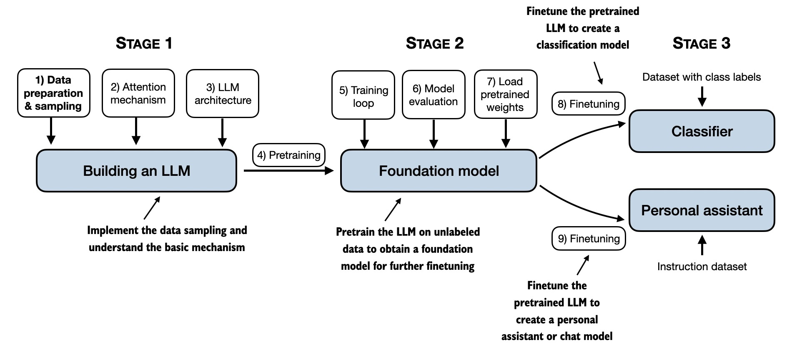

# 从一张流程图理解 LLM 训练：预训练与后训练

> 用一问一答，理解模型搭建、训练和使用，以及 batch、step、epoch 的关系。
>
> 起点：[LLMs from Scratch 项目中的学习流程图](https://github.com/rasbt/LLMs-from-scratch)。



图源：Sebastian Raschka，[LLMs-from-scratch README](https://github.com/rasbt/LLMs-from-scratch#readme) 中的 [mental model 原图](https://sebastianraschka.com/images/LLMs-from-scratch-images/mental-model.jpg)。此处保存原图，便于随笔记查看。

## 1. 图里的三个阶段分别在做什么？

- **搭建模型**：实现数据处理、注意力机制和模型结构，并初始化参数。
- **得到基础模型**：进行预训练、评估效果；也可以加载已有的预训练权重。
- **针对用途微调**：例如训练分类器，或训练按指令回答的聊天助手。

这是书的教学分段。第一阶段的内容是预训练的基础，并不是与预训练无关的另一件事。

## 2. 搭建模型和训练模型有什么区别？

搭建模型，是写出“模型如何计算”的程序，并给参数设置初始值。

训练模型，是用数据计算预测误差，再据此调整参数。参数通常从随机值开始；“没训练”指尚未通过训练学到有用的规律，不是没有输入过数据。

## 3. train、pre-training、post-training 是什么关系？

**train（训练）是总称**。讨论 LLM 时，通常先分成两大块：

- **预训练（pre-training）**：从大量文本学习语言规律、知识和通用能力。
- **后训练（post-training）**：在预训练模型上继续训练，改善指令遵循、任务表现、偏好等。

后训练可以包含多个步骤，指令微调是其中一种。微调泛指在已有模型上继续训练，不只用于聊天助手。

**推理（inference）**则是使用模型生成回答，通常不更新参数。它不是第三种训练。

## 4. 预训练具体在做什么？

对常见的 GPT 类模型，核心练习是：**根据前面的词元，预测下一个词元。**

用字简化演示，原文是“我喜欢喝茶”：

| 输入 | 预测目标 |
|---|---|
| 我 | 喜 |
| 我喜 | 欢 |
| 我喜欢 | 喝 |
| 我喜欢喝 | 茶 |

真实单位是 token（词元），不一定是一个字或一个完整的词。目标直接来自原文，不需要人另外编写问答。

## 5. 预训练、后训练和推理怎么串起来？

```text
模型结构＋初始参数
        ↓ 预训练：用大量文本调整参数
预训练模型
        ↓ 后训练：继续调整已有参数
后训练模型
        ↓ 推理：输入用户问题，生成回答
回答
```

训练主要留下的是**更新后的模型参数**；推理产生的是**回答**。后训练接着使用预训练的参数，不是重新初始化一个模型。

下面是表达连接关系的 Python 风格伪代码，不能直接运行；模型、编码和优化器细节都已省略：

```python
model = Model()  # 创建结构，初始化参数

def train_step(inputs, targets):
    predictions = model(inputs)
    loss = compare(predictions, targets)
    update_parameters(model, loss)

# 预训练：输入和预测目标来自普通文本
for batch in text_batches:
    inputs, targets = prepare_next_token_batch(batch)
    train_step(inputs, targets)

# 后训练示例：指令微调，继续使用同一个模型
for batch in instruction_answer_batches:
    inputs, targets = prepare_instruction_batch(batch)
    train_step(inputs, targets)  # 通常重点计算回答部分的误差

# 推理：生成回答，不执行参数更新
answer = generate(model, "你好")
```

预训练与指令微调可以使用相似的训练动作；主要区别在起始参数、数据和训练目标。其他后训练方法也可能使用奖励或偏好信号，并不全部等同于示范问答训练。

## 6. 模型是一行一行数据训练的吗？

通常是一批数据一起计算，这一批叫 **batch**。例如，一次取 32 段文本，每段里的多个位置都提供预测目标，把误差汇总后用于更新参数。

不是任意排列组合文字，而是保持原来的顺序，在各个位置预测紧接着的词元。上面的表格只是解释目标，实际通常不需要把所有前缀逐行复制出来；多个位置可以并行计算。

## 7. 32 段文本，大约有多少条预测目标？

假设每段约 1,000 个词元：

```text
32 段 × 约 1,000 个位置 ≈ 32,000 个预测目标
```

是**几万个目标**的量级，但不等于必须存成几万行数据。实际数量取决于切分方式、填充，以及哪些位置参与误差计算。

## 8. step 和 epoch 有什么区别？同一份数据只用一次吗？

- **Step**：通常指一次参数更新。
- **Epoch**：把整个训练集完整过一遍。

例如，共有 64 段文本，每批 32 段。在每批更新一次参数的简单设置下，两个 step 就完成一个 epoch。

若再训练一个 epoch，同一份数据会再次使用，通常会打乱分批顺序。训练可以只过一遍，也可以过多遍，取决于安排；参数始终在上一次的基础上继续更新。

补充：使用梯度累积时，可以计算多个 batch，再统一更新一次参数，因此一个 batch 不一定对应一个更新 step。
